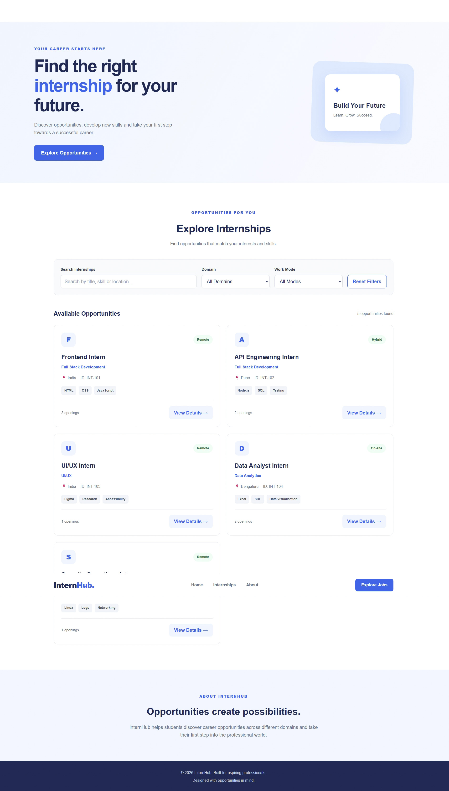
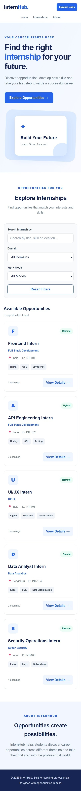

# InternHub – Responsive Internship Board

A responsive and accessible internship listing platform that helps students explore internship opportunities across different domains.

## 🌐 Live Demo

Coming soon!

## 📌 Project Overview

InternHub is a beginner-friendly web development project created as part of the Edvyro internship task.

The platform allows students to browse internship opportunities, search by keywords, filter listings by domain and work mode, and view detailed internship information.

## ✨ Features

- Responsive design for mobile, tablet and desktop.
- Dynamic internship cards generated using JavaScript.
- Search internships by title, domain, location and skills.
- Filter internships by domain.
- Filter internships by work mode.
- Reset all filters with one click.
- Internship details popup.
- Application form with input validation.
- Duplicate application prevention within the same browser.
- Loading, error and empty-result states.
- Keyboard-friendly interactions.

## 🛠️ Technologies Used

- HTML5 – Semantic page structure.
- CSS3 – Responsive layouts and styling.
- JavaScript – DOM manipulation and interactive functionality.
- JSON – Internship records and data management.
- GitHub Pages – Deployment (planned).

## 📂 Project Structure

```text
responsive-internship-board/
│
├── data/
│   └── internships.json
│
├── screenshots/
│   ├── desktop.jpg
│   └── mobile.jpeg
│
├── index.html
├── styles.css
├── app.js
└── README.md
```

## 📸 Screenshots

### Desktop View



### Mobile View



## 🚀 How to Run Locally

1. Download or clone this repository.
2. Open the project folder in Visual Studio Code.
3. Install the Live Server extension.
4. Right-click `index.html`.
5. Select **Open with Live Server**.
6. Explore the internship listings in your browser.

## 📊 Internship Data

The project currently includes five sample internship records:

1. Frontend Intern – Full Stack Development.
2. API Engineering Intern – Full Stack Development.
3. UI/UX Intern – UI/UX.
4. Data Analyst Intern – Data Analytics.
5. Security Operations Intern – Cyber Security.

All internship records are fictional sample data stored in `data/internships.json`.

## ♿ Accessibility

The project includes semantic HTML, labelled form controls, keyboard-accessible interactions and responsive layouts.

## ⚠️ Project Limitations

This is a frontend demonstration project. Application data is not submitted to a real company or stored on a server. Duplicate prevention uses browser local storage and is limited to the current browser.

## 👩‍💻 Developer

**Insha Hossain**

B.Tech – Electronics and Communication Engineering

Project: Responsive Internship Board

---

*Built with HTML, CSS and JavaScript.*